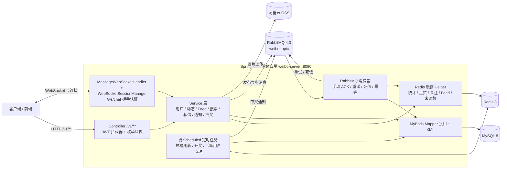

# 类微博社交内容平台

基于 **Spring Boot 3 + Java 17** 开发的单体（Monolith）类微博社交后端项目。实现了用户注册登录、动态发布与转发、关注关系、Feed 信息流、点赞评论、私信实时通信、抽奖活动、图片上传等社交平台常见能力。

项目采用经典单体分层架构，所有业务运行在同一个 Spring 进程内。通过 **Redis** 缓存高频读数据和社交关系（关注集合、点赞集合、统计计数、Feed 收件箱、消息中心未读数等），通过 **RabbitMQ** 异步处理扇出、计数落库、通知聚合等适合最终一致性的任务，通过 **WebSocket** 提供在线私信的双向实时通信，通过 **阿里云 OSS** 存储用户上传的图片。

> 说明：本项目是单体应用，**不是**微服务架构，工程中没有引入网关、注册中心、配置中心等分布式组件。

---

## 1. 项目简介

- **定位**：类微博社交内容平台后端，覆盖注册、内容发布、社交互动和消息通知等主要用户流程。
- **主要业务模块**：用户与认证、动态（微博）发布/转发/删除、关注与 Feed 时间线、点赞/评论/二级回复、热门话题与热门微博、关键词搜索、一对一私信与消息通知、转发抽奖活动、图片上传。
- **核心技术**：Spring Boot 3、MyBatis + Druid + MySQL、Spring Data Redis（Lettuce）、Spring AMQP + RabbitMQ、Spring WebSocket、jjwt、阿里云 OSS SDK、@Scheduled 定时任务。
- **架构特点**：单体分层架构（Controller → Service → Mapper → DB）+ Redis 缓存加速 + RabbitMQ 异步解耦 + WebSocket 实时推送。根据业务场景采用不同的数据一致性策略：点赞关系、评论计数等部分写操作采用「Redis 先更新、MQ 异步落库」；部分异步业务在 MQ 消费者完成数据库事务后，通过事务回调维护 Redis；关注/取关等同步业务以 MySQL 事务为准，提交后通过事务回调增量维护 Redis 集合、统计数据与 Feed。Feed 扇出由 MQ 消费者异步写入 Redis 收件箱（无独立 DB 表）。

> 本项目只做后端，配套前端项目见 [weibo-web](https://github.com/NullBullet/weibo-web)；运行与联调也可借助 Postman 等 HTTP 客户端。

---

## 2. 核心功能

按业务模块分组，均以当前仓库实际实现为准。

### 2.1 用户与认证

- 图形验证码：`GET /v1/auth/captcha`，验证码存 Redis 300 秒，同一 IP 每 120 秒最多 5 次。
- 注册：用户名唯一校验、密码长度 ≥ 6、MD5 摘要存储，注册后初始化用户统计缓存。
- 登录：一次性验证码校验、同 IP 每 60 秒最多 5 次、账号连续失败 5 次锁定 300 秒；成功后签发 JWT（默认有效期 2 小时），并异步发送登录日志到 MQ。
- 登出：目前**仅返回成功**，没有实现服务端 token 黑名单/失效机制。

### 2.2 社交动态（微博）

- 发布：正文 + 可选多图，写入 `statuses`/`status_images`，初始化帖子统计缓存，并异步扇出 Feed。
- 转发：处理转发链（转发的是原微博），异步落库；消费者在数据库事务提交后维护原微博 `forwardCount`、热榜、用户时间线与 Feed。接口同步返回 `RepostVO`（`originalStatusId` + 抽奖同步校验结果 `reward`），转发落库成功（或重试耗尽进死信）后通过 WebSocket 推送 `REPOST_RESULT`，前端以此确认落库结果。
- 删除：仅校验所有权，删除动作通过 MQ `post.delete` 异步完成（Redis 清理 + 软删除）。

### 2.3 关注与 Feed 流

- 关注/取关：`/v1/follows/follow`、`/unfollow` 在同一个数据库事务内更新 `user_following`、`user_follower` 与 `user_statistics` 计数；提交成功后通过 `afterCommit` 回调增量维护 Redis：SADD/SREM 关注/粉丝集合、HINCRBY 统计计数并续期 TTL，同时维护当前用户 Feed（关注回填被关注者最近帖子、取关移除其帖子）。
  - 说明：MySQL 与 Redis 之间没有分布式事务，Redis 更新发生在提交之后，避免数据库回滚而缓存已变更；关注/粉丝集合重建使用 `SET NX PX` 锁 + double-check，避免并发重复重建。
- 关注状态查询 `/v1/follows/check`、关注/粉丝列表 `/v1/users/following`、`/followers`、`/following/active`。

### 2.4 点赞与统计

- 帖子/评论点赞取消：`POST /v1/post/toggleLike`（`targetType=1` 帖子、`2` 评论）。Redis 集合先写、计数 Hash 更新，再异步落库 `attitudes`。
- 评论点赞：增加/回撤评论作者获赞数（DB + Redis 同步）；同时投递评论点赞通知，与帖子点赞共用 `notification_like` 聚合。
- 当前**浏览量 `viewsCount` 只在帖子 VO 中读取展示，没有浏览自增埋点**，不会随浏览实时增长。

### 2.5 评论与二级回复

- 一级评论、二级回复列表、删除评论。评论插入同步写库、Redis 计数同步更新，评论计数的 DB 更新走 MQ；评论/回复列表有分页缓存（见 5.2）。

### 2.6 搜索与热门内容

- 帖子搜索（`GET /v1/search/weibos`）：`searchType=0` 综合、`1` 实时。综合模式默认召回最近 31 天最多 500 条，带关键词 ID 缓存并做内存综合排序；实时模式直接 DB 分页，不做搜索缓存。
- 用户搜索（`GET /v1/search/users`）：基于 `LIKE` 模糊查询并分页返回。
- 热门话题（`GET /v1/hot/topics`）：直接查询 `hot_topics` 表。
- 热门微博（`GET /v1/hot/posts`）：读取 Redis 热门榜 ZSET，游客可访问、登录后附带点赞/关注状态，每 5 分钟由定时任务按热度公式刷新。

### 2.7 私信与消息通知

- **私信**：REST（会话/历史/未读）+ WebSocket（在线实时收发）。`/v1/message/*` 提供会话列表、历史消息（单页上限 100）、标记已读。
- **通知**：点赞聚合通知（帖子 + 评论）、评论通知、系统通知（分页/全部已读）。点赞、评论、系统通知均提供全部已读接口（`/v1/notifications/{likes|comments|system}/read-all`）。
  - 点赞聚合通知使用 `last_like_time + notification_id` 复合游标分页，每页固定 20 条，响应返回 `records / nextCursor / hasMore`。
  - 点赞通知分页结果使用 Redis 旁路缓存 `notification:like:{receiverId}:{cursorTime}:{cursorId}:{size}`，TTL 固定 30 秒、命中不续期；点赞/取消点赞消费者在数据库事务提交后按 receiver 删除全部分页缓存，TTL 作为兜底。
- **消息中心未读数**：`GET /v1/notifications/unread-count` 返回私信、评论、点赞、系统四类未读数；WebSocket 连接建立、新私信/点赞/评论/中奖通知落库后以及私信标记已读后推送 `UNREAD_COUNT`（四类合计）。
  - 四类未读数使用 Redis 旁路缓存 `notification:unread:{userId}`（Hash：`chat`/`comment`/`like`/`system`），TTL 7 天；读取命中续期，未读数变化（新私信、通知落库、标记已读）在事务提交后按 MySQL 重算并续期；key 缺失或字段残缺时按 MySQL 重建，重建与刷新使用 `SET NX PX` 锁 + double-check；Redis 异常或刷新失败时降级直读 MySQL。

### 2.8 抽奖活动

- 创建活动（限量参与 / 时间范围两种类型，支持 `fanOnly` 开关）、转发原微博自动参与、通过 Redis Lua 原子校验状态/去重/库存、MQ 异步持久化参与记录、定时开奖并发送中奖通知。
- 参与结果分两段返回：同步校验阶段（未开始/已结束/非粉丝/重复/名额满）不进入 MQ，直接随转发接口的 `RepostVO.reward`（state：`PENDING`/`JOINED`/`FULL`/`ENDED`/`NOT_STARTED`/`NOT_FAN`，无活动时为 `null`）同步返回；校验通过后（`PENDING`）由消费者在参与记录落库成功或落库失败进死信时推送 WebSocket `REWARD_RESULT`（`JOINED`/`SAVE_FAILED`）确认最终结果，前端无需再轮询 `GET /v1/reward/activity?statusId=xxx`（该接口已标记 `@Deprecated`）。
- 活动系统异常不会影响转发接口返回：抽奖校验失败仅记录日志并返回 `reward = null`，避免已受理的转发请求返回失败后前端重试造成重复转发。
- 活动详情、参与名单、中奖名单、我的抽奖记录等查询接口。
- `fanOnly` 校验：转发参与时检查参与者的关注集合 `follow:following:{userId}` 是否包含活动创建者（即参与者是否已关注创建者），读取前通过 `FollowSetHelper.ensureFollowing` 在缓存缺失时从数据库重建，避免已关注的用户被误拒。

### 2.9 图片上传

- `POST /v1/upload/image`：保存微博配图到阿里云 OSS；`PUT /v1/users/me/profile` 支持头像上传并删除旧头像。

---

## 3. 技术栈

| 技术            | 版本                                                                                          | 实际作用                                              |
| --------------- | --------------------------------------------------------------------------------------------- | ----------------------------------------------------- |
| Java            | 17（`java.version=17`）                                                                       | 开发语言                                              |
| Spring Boot     | 3.5.13                                                                                        | 应用框架（父 POM `spring-boot-starter-parent`）       |
| Maven           | 多模块（3.x，构建实际使用 3.9.11）                                                            | 依赖与模块管理                                        |
| MyBatis         | `mybatis-spring-boot-starter` 3.0.3                                                           | 持久层框架（XML + 注解，开启驼峰映射）                |
| MySQL           | 8（docker 镜像 `mysql:8`）                                                                    | 关系型数据存储（连接驱动 `mysql-connector-j 8.0.33`） |
| Druid           | 1.2.20                                                                                        | JDBC 连接池                                           |
| Redis           | 8（docker 镜像 `redis:8`）；客户端为 Spring Data Redis + Lettuce，版本由 Spring Boot BOM 管理 | 缓存、Set/ZSet/Hash、分布式锁、Lua 脚本、限流         |
| RabbitMQ        | 4.3（docker 镜像 `rabbitmq:4.3-management`）                                                  | 异步消息（Spring AMQP）                               |
| WebSocket       | `spring-boot-starter-websocket`                                                               | 在线私信双工通信                                      |
| JWT (jjwt)      | 0.13.0                                                                                        | 用户令牌签发与校验（HS256）                           |
| 阿里云 OSS SDK  | `aliyun-sdk-oss` 3.18.4                                                                       | 图片上传/删除                                         |
| Hutool          | 5.8.28                                                                                        | 工具集（验证码图片生成、JSON 等）                     |
| Spring Actuator | Spring Boot 托管版本                                                                          | 提供 `/actuator/health` 健康检查                      |
| Docker Compose  | —                                                                                             | 本地编排 MySQL / Redis / RabbitMQ 三个依赖服务        |

> 版本说明：Java、Spring Boot、MyBatis、Druid、jjwt、OSS、Hutool、MySQL 驱动来自各 `pom.xml`；MySQL 8、Redis 8、RabbitMQ 4.3 来自根目录 `docker-compose.yml` 的镜像标签，并非运行的精确小版本。Lettuce 与 Spring AMQP 未显式指定版本，交由 Spring Boot BOM 管理。

---

## 4. 系统架构



**架构说明**

- 同步链路（HTTP）：`Controller → Service → Mapper → MySQL`，其中高频读数据先走 Redis（RedisTemplate + 手写 Helper），未命中时回源 DB；帖子/用户等批量读取场景使用 Pipeline 批量回写缓存。
- 异步链路（RabbitMQ TopicExchange `weibo.topic`）：点赞/评论/转发/删除/Feed 扇出/登录日志/抽奖参与与中奖等通过消息解耦，消费者带手动 ACK、重试队列、死信队列与 Redis 幂等。
- WebSocket 与 HTTP 复用同一套 JWT 校验逻辑和 Spring 上下文；`MessageWebSocketHandler → MessageService → Mapper → MySQL` 负责消息持久化与推送，连接注册、移除与发送统一由 `WebSocketSessionManager` 处理。
- **WebSocket 在线会话仅保存在单实例 JVM 内存中**，未使用 Redis 做会话广播，多实例部署无法保证向任意在线用户推送成功（见 5.4）。
- 未引入网关、注册中心、配置中心等额外组件。

---

## 5. 核心技术设计

### 5.1 统一返回与全局异常

**业务问题**：需要对所有 HTTP 接口保持一致的返回结构，业务异常能统一收敛为约定的错误格式。

**实现方案**

- 统一返回对象 `Result<T>`：`code=1` 成功、`code=0` 失败，附带 `msg` 与泛型 `data`。
- 分页对象：`PageResult{total, records}`（偏移量分页）、`ScrollResult{lastScore, offset, records}`（游标分页，用于时间线/热门/收件箱）。
- 全局异常 `GlobalExceptionHandler`（`@RestControllerAdvice`）：只拦截自定义的 `BaseException`，返回 `Result.error(msg)`。
  - 限制：**未统一捕获非业务异常**（如 Jakarta/Servlet、框架层异常），这类异常不会包装成 `Result`。
- JWT 鉴权：`JwtTokenUserInterceptor` 从请求头 `Authorization` 直接读取 token（**无 `Bearer ` 前缀**），解析出 `userId` 写入 ThreadLocal 封装的 `BaseContext`，请求结束清理；验证失败返回 HTTP 401 空响应体。
  - 默认拦截 `/v1/**`，仅放行 5 个免认证路径：`/v1/auth/login`、`/v1/auth/captcha`、`/v1/auth/register`、`/v1/hot/topics`、`/v1/hot/posts`。

### 5.2 Redis 缓存与 Feed 流

**业务问题**：社交平台的关系、计数、列表是高频读场景，直接穿透 DB 会产生大量重复查询；缓存 miss 且多个请求同时到达时，还可能出现缓存击穿与缓存不一致。

**实现方案**：缓存逻辑主要由手写 Helper 类封装（未使用 `@Cacheable` 声明式注解），部分业务直接使用 RedisTemplate，按数据形态采用不同重建策略：

- **统计 Hash（帖子/用户/评论）**：读前校验字段完整；miss 或残缺时用 `SET NX PX` 分布式锁 + double-check + `HSETNX` 字段补齐，抢锁失败先短暂轮询，超时降级查库；写回用 `HSETNX` 保留并发增量。
- **关系/集合（关注、粉丝、点赞、用户帖子）**：缺失时条件重建，关注/取关事务提交后通过 SADD/SREM/HINCRBY 增量维护关系与统计，点赞集合依赖 `SADD` 幂等，用户帖子在 key 缺失时全量重建，避免生成半截快照；关注/粉丝集合重建使用 `SET NX PX` 锁 + double-check，避免并发重复重建。
- **Feed 收件箱**：写路径只向已存在的 key 追加并裁剪，读路径缺失时从 DB 重建；重建入口使用 `SET NX PX` 锁 + double-check，避免并发重复重建。
- **点赞通知分页**：按 receiver + 游标维度旁路缓存，固定 30 秒 TTL、命中不续期；分页索引记录已缓存页，点赞消费者事务提交后统一删除。
- **统一未读数（私信/评论/点赞/系统）**：旁路缓存 Hash `notification:unread:{userId}`，读取命中续期 7 天；未读数变化（新私信、评论/点赞/系统通知落库、标记已读）在事务提交后按 MySQL 重算四类计数并续期，避免把未提交的计数写入缓存；key 缺失或字段残缺时按 MySQL 重建，重建与刷新共用 `SET NX PX` 锁 + double-check，Redis 异常或刷新失败时降级直读 MySQL。

主要 Redis Key 与数据结构：

| 业务           | Key                                                             | 结构         | TTL                                      | 说明                                     |
| -------------- | --------------------------------------------------------------- | ------------ | ---------------------------------------- | ---------------------------------------- |
| 关注/粉丝      | `follow:following:{id}` / `follow:fans:{id}`                    | Set          | 7 天                                     | 空集合用哨兵值 `"0"` 防穿透              |
| 点赞集合       | `like:post:{id}` / `like:comment:{id}`                          | Set          | 7 天                                     | 从 `attitudes` 条件重建                  |
| 用户统计       | `user:stats:{id}`                                               | Hash         | 7 天                                     | 关注/粉丝/获赞数，重建锁 30 秒           |
| 帖子统计       | `post:stats:{id}`                                               | Hash         | 7 天                                     | 赞/评/转/浏览/创建时间，重建锁 30 秒     |
| 评论统计       | `comment:stats:{id}`                                            | Hash         | 7 天                                     | 回复数/点赞数                            |
| 用户帖子时间线 | `user:post:ids:{id}`                                            | ZSet         | 7 天                                     | key 存在才增量、缺失全量重建             |
| 帖子详情       | `post:detail:{id}`                                              | String(JSON) | 普通 1800s / 热门 86400s（均加随机抖动） | 不缓存嵌套转发对象                       |
| 用户信息       | `user:info:{id}`                                                | String(JSON) | 86400s + 随机抖动                        | 昵称/头像                                |
| 个人资料       | `user:profile:{id}`                                             | String(JSON) | 3600s + 随机抖动                         | 不含实时统计                             |
| 评论/回复列表  | `post:comment:list:{postId}:{page}:{pageSize}` 等               | String(JSON) | `300 + random(0~299)` 秒                 | 带 `:pages` 页索引与常见页兜底           |
| 点赞通知分页   | `notification:like:{receiverId}:{cursorTime}:{cursorId}:{size}` | String(JSON) | 固定 30 秒，不续期                       | 带 `:pages` 页索引，点赞消费者提交后删除 |
| 统一未读数     | `notification:unread:{id}`                                      | Hash         | 7 天，读取命中与未读数变化时续期         | chat/comment/like/system，重建锁 30 秒   |
| Feed 收件箱    | `feed:user:{id}`                                                | ZSet         | 7 天                                     | **无独立 DB 表**，见下                   |
| 热门候选/榜单  | `hot:post:candidate` / `hot:post:zset`                          | Set / ZSet   | —                                        | 定时任务刷新                             |
| 活跃用户       | `active:users`                                                  | ZSet         | —                                        | 登录日志消费时写入，每日 0 点清理        |
| MQ 幂等        | `mq:idempotent:{messageId}`                                     | String       | 7 天                                     | 消费者去重                               |
| 验证码/限流    | `captcha:{id}`、`ip:captcha:{ip}` 等                            | String       | 见认证                                   | 一次性验证码/IP 防刷/失败计数            |

**Feed 收件箱（重点）**

- 收件箱由 Redis ZSET `feed:user:{userId}` 承载，score 为发帖时间戳，**设计上限为最近 200 条，无独立数据库表**。
- 写路径（`FeedConsumer` 扇出）：发帖后通过 pipeline 批量探测粉丝收件箱 key 是否存在，**只向已存在的活跃收件箱追加**并裁剪到 200 条，缺失的 key 直接跳过——避免给长期未登录用户写冷 key。
- 读路径（首页时间线）：`feed:user:{id}` 缺失时，按当前用户关注对象整体查询最近 200 条未删除帖子（SQL `limit 200`，不是每个关注者各 200 条）并从 DB 聚合重建，写入 7 天 TTL；重建使用 `SET NX PX` + double-check 防止并发重复重建，且只通过 ZADD 追加成员，不做整键覆盖。关注/取关提交后的回调会分别回填被关注者最近帖子、移除被取关者帖子；回填后若收件箱超过上限，由后续扇出写路径的裁剪逻辑收敛。
- 首页时间线支持模式参数 `timelineType`：`LATEST`(2) 按时间倒序游标分页；`HOT`(1) 从收件箱取最近最多 1000 条，按热门榜分数混合排序后游标分页。

**热门内容与统计**

- 热度公式（`HotScoreCalculator`）：`interaction = like + comment*3 + forward*5`；`hot = (log10(view+1) + log10(interaction+1)) / (hours+2)^1.8`。用对数压缩量级、时间项指数衰减，实现新内容自然上榜、旧内容平滑下降。
- `HotRankTask` 每 **5 分钟**遍历候选集 `hot:post:candidate` 重算热度分并刷新 ZSET，清理已软删/冷帖。

### 5.3 RabbitMQ 异步处理

**业务问题**：点赞、评论、转发、删除、Feed 扇出等操作涉及计数落库、通知聚合等多步任务，放同步请求会拉长接口耗时，也难以统一管理重试与最终一致。

**实现方案**

- 唯一 TopicExchange `weibo.topic`，消息使用 Jackson JSON 序列化。
- 队列均声明为 durable；每个业务队列各配有独立的死信交换机/死信队列、5 秒 TTL 重试队列；消费失败重试达到上限（默认 3 次）后 basicNack（`requeue=false`）进入死信队列。
- 消费者统一模式：先查 Redis 幂等 key `mq:idempotent:{messageId}`，已处理则直接 ACK；未处理则执行业务、写 7 天幂等标记、手动 ACK；异常时重发到 5 秒重试队列。
- 队列与路由（均已在 `RabbitMQConfig` 声明绑定）：

| 队列                   | 绑定 Routing Key                             | 业务用途                                                 |
| ---------------------- | -------------------------------------------- | -------------------------------------------------------- |
| `like.queue`           | `post.like`、`post.cancel`                   | 帖子点赞/取消 DB 落库                                    |
| `notice.like.queue`    | `post.like`、`post.cancel`、`comment.like.*` | 帖子/评论点赞聚合通知（与 like / comment.like 多消费者） |
| `comment.queue`        | `comment.*`                                  | 评论计数 DB 更新                                         |
| `comment.like.queue`   | `comment.like.*`                             | 评论点赞 DB 落库                                         |
| `notice.comment.queue` | `comment.create`                             | 评论通知                                                 |
| `feed.queue`           | `feed.publish`                               | 发帖向粉丝收件箱扇出                                     |
| `login.log.queue`      | `login.log`                                  | 登录日志、活跃用户维护                                   |
| `repost.queue`         | `post.repost`                                | 转发微博创建与统计                                       |
| `post.delete.queue`    | `post.delete`                                | 异步删除缓存 + 软删除                                    |
| `reward.join.queue`    | `reward.join`                                | 抽奖参与持久化                                           |
| `reward.win.queue`     | `reward.win`                                 | 中奖系统通知                                             |

**异步与 MySQL / Redis 的关系**：点赞、评论计数等写操作先同步更新 Redis 集合并返回，再由消费者把点赞关系/计数最终落到 MySQL；删除微博、Feed 扇出、通知聚合和缓存清理由消费者完成，避免阻塞主请求线程。关注/取关以 MySQL 事务为准，提交后回调增量维护 Redis，不走 MQ。

**如实说明（能力边界）**

- 生产端开启了 publisher-confirm（correlated）、publisher-return、`mandatory=true`，但 `RabbitConfirmConfig`/`RabbitReturnConfig` 仅记录日志，**没有消息落库与自动补发**。
- 死信消费者当前**只打印 ERROR 日志并 ACK**，代码标注 `//todo 保存db / 发送告警`，尚未持久化失败消息或发告警。
- 因此「极端情况下消息可能丢失/无补偿」是当前真实状态，README 不做夸大。

### 5.4 WebSocket 在线私信

**业务问题**：私信是双向实时通信，需支持同用户多标签页在线、消息不重复、网络闪断重连等。

**实现方案与关键点**

- 握手认证：连接地址 `/ws/chat?token={JWT}`，`JwtHandshakeInterceptor` 从 query 参数校验 JWT，失败返回 401 拒绝；成功后把 `userId` 与 token 过期时间写入会话属性。连接存活期间 token 过期后，下一次消息处理会返回 `ERROR` 并关闭连接。
- 会话管理：`WebSocketSessionManager` 统一维护 JVM 内存 `ConcurrentHashMap<Long, List<WebSocketSession>>` 及连接注册/移除/发送，同一用户多连接都接收广播；会话包装为 `ConcurrentWebSocketSessionDecorator`（10 秒发送超时、512KB 输出缓冲上限）。
- 连接级限流：每个连接独立令牌桶，默认每秒 10 令牌、桶容量 20，超限拒绝 CHAT。
- 心跳与空闲清理：客户端发 `PING` 服务端回 `PONG`；`@Scheduled(fixedDelay=60_000)` 每分钟扫描，超过 `idle-timeout-seconds`（默认 300 秒）未收到消息的连接被关闭。
- 消息类型（共 9 种）：客户端 `PING`、`CHAT`；服务端 `PONG`、`MESSAGE_ACK`、`NEW_MESSAGE`、`UNREAD_COUNT`（消息中心总未读数）、`ERROR`、`REPOST_RESULT`（转发落库结果）、`REWARD_RESULT`（抽奖参与落库最终结果）。
- 未读数推送：连接建立时推送一次 `UNREAD_COUNT`（私信 + 评论 + 点赞 + 系统合计，读取统一未读数缓存，缺失时按 MySQL 重建）；新私信、点赞/评论通知、中奖通知落库后以及私信标记已读后，按 MySQL 重算并续期缓存后再推送。
- CHAT 参数：`conversationId` 必填；`content` 非空且长度 ≤ 1000；`clientMessageId` 非空且 ≤ 64 字符。
- 幂等与持久化：入库前先按 `senderId + clientMessageId` 查重，命中则返回已存消息（`MESSAGE_ACK`）且**不再重复推送**；数据库唯一键冲突时用 `SELECT ... FOR UPDATE` 补偿查询。消息保存成功后向接收方全部在线连接推送 `NEW_MESSAGE` 并刷新未读数。
- 已读机制：`POST /v1/message/read` 以当前最大消息 ID 为基准批量标记已读，用「原子递减本次条数」而不是无条件清零，与发送方的条件自增可交换，使并发下未读数不丢失。

**如实说明（能力边界）**

- 当前 WebSocket 会话**只存在单实例 JVM 内存**，未用 Redis 做跨节点广播，**不具备多实例集群推送能力**。
- 离线消息仅持久化到 MySQL；重连后通过 WebSocket 推送消息中心总未读数，历史消息通过 REST `/v1/message/history` 分页查询，没有 WebSocket 离线消息队列。

### 5.5 定时任务

- `HotRankTask`：`0 */5 * * * *`，**每 5 分钟**刷新热门榜。
- `RewardDrawTask`：`0 * * * * *`，**每分钟**对已结束未开奖的活动随机抽奖并发送中奖消息。
- `ActiveUsersCleanupTask`：`0 0 0 * * ?`，**每天 0 点**清理 `active:users` 中超过 7 天的记录。

---

## 6. 项目目录结构

```
weibo/
├── docker-compose.yml              # 本地开发依赖中间件（MySQL/Redis/RabbitMQ）编排
├── pom.xml                         # 父 POM（Spring Boot 3.5.13, Java 17, 统一版本与依赖管理）
├── .gitignore
├── weibo-common/                   # 模块一：公共能力
│   └── src/main/java/com/jun/
│       ├── constant/               # RedisConstants、JwtClaimsConstant、MessageConstant、StatusConstant
│       ├── context/                # BaseContext（ThreadLocal 用户上下文）
│       ├── enumeration/            # SearchType / TargetType / TimelineType
│       ├── exception/              # BaseException 及子类（账号/密码/关注/上传等）
│       ├── properties/             # JwtProperties、OssProperties（@ConfigurationProperties）
│       ├── result/                 # Result / PageResult / ScrollResult
│       └── utils/                  # JwtUtil、HotScoreCalculator、OssUtil、IpUtil
├── weibo-pojo/                     # 模块二：数据模型
│   └── src/main/java/com/jun/
│       ├── dto/                    # 接口入参（LoginDTO、HomeQueryDTO、ScrollDTO、ChatMessageDTO 等）
│       ├── entity/                 # 数据库表实体（User、Statuses、Comment、Message 等）
│       ├── model/                  # 内存计算模型（ScoredPost 等）
│       └── vo/                     # 出参视图（UserVO、StatusVO、MessageVO、RewardActivityVO 等）
└── weibo-server/                   # 模块三：主应用（启动与装配）
    ├── src/main/
    │   ├── java/com/jun/
    │   │   ├── config/             # Redis、RabbitMQ 与监听容器、Confirm/Return 回调、WebMvc、WebSocket、OSS 配置
    │   │   ├── consumer/           # RabbitMQ 业务消费者 + 死信消费者
    │   │   ├── controller/v1/user/ # 全部 REST Controller（Auth/Users/Statuses/Post/Comments/Follow/Home/Hot/Search/Message/Notifications/Reward/Upload）
    │   │   ├── converter/          # String→枚举转换器
    │   │   ├── handler/            # GlobalExceptionHandler
    │   │   ├── interceptor/        # JwtTokenUserInterceptor、JwtHandshakeInterceptor
    │   │   ├── mapper/             # MyBatis Mapper 接口（含注解 SQL）
    │   │   ├── mq/message/         # MQ 消息体 POJO（LikeMessage、FeedMessage、CommentMessage 等）
    │   │   ├── service/(impl)      # Service 接口与实现
    │   │   ├── task/               # HotRankTask / RewardDrawTask / ActiveUsersCleanupTask
    │   │   ├── utils/              # 缓存 Helper（FeedHelper、PostStatsHelper、NotificationUnreadCacheHelper 等）
    │   │   ├── websocket/          # MessageWebSocketHandler（协议处理）、WebSocketSessionManager（连接管理）
    │   │   └── WeiboServerApplication.java
    │   └── resources/
    │       ├── mapper/             # MyBatis XML SQL
    │       ├── sql/init.sql        # 数据库建库/建表脚本（schema-only，不含测试数据）
    │       ├── reward_join.lua     # 抽奖参与 Redis Lua 原子脚本
    │       ├── application.yaml    # 主配置（port/profiles/占位符数据源/Redis/RabbitMQ/MyBatis/JWT/WebSocket/OSS）
    │       └── application-dev.yml # dev 环境实际取值（DB/Redis/MQ/OSS）
    └── src/test/                   # 测试代码（@Test 目前均被注释，见第 10 章）
```

仓库根目录没有 `Dockerfile`、`LICENSE`、Swagger/OpenAPI 文档；数据库初始化脚本位于 `weibo-server/src/main/resources/sql/init.sql`。

---

## 7. 环境要求与快速启动

### 7.1 前置环境

- **JDK 17**（`pom.xml` 指定 `java.version=17`；请确认 `JAVA_HOME` 指向 JDK 17）。构建实际上使用的是 Maven 3.9.11 + JDK 17.0.12。
- **Maven 3.x**（本次构建实际使用 Maven 3.9.11）。
- **Docker & Docker Compose**（用于启动依赖中间件）。
- **阿里云 OSS 配置**（图片上传必需）。`application-dev.yml` 中 OSS AK/SK 通过环境变量引用；如果环境变量未提供，按 Spring 占位符解析规则应用可能启动失败（尚未在本环境实际验证）。OSS 配置见 7.4。

### 7.2 启动依赖中间件

根目录 `docker-compose.yml` 只编排了 MySQL 8、Redis 8、RabbitMQ 4.3-management 三个基础服务（**没有应用容器，也没有 healthcheck**）：

```bash
# Docker Compose V2（Docker Desktop 自带）
docker compose up -d

# 若本机仅安装旧版 docker-compose，可使用：
# docker-compose up -d
```

启动后端口：

- MySQL `localhost:3306`；Redis `localhost:6379`（开启 AOF）；RabbitMQ `localhost:5672`，管理后台 `http://localhost:15672`（默认账号请按 RabbitMQ 镜像/官方文档配置，README 不展示口令）。
- 数据库/Redis 的本地口令见 `application-dev.yml`，README 不展示；请用你自己的值，不要照抄提交。
- `docker-compose.yml` 只设置了 MySQL 管理员账号的密码，不会自动执行项目建表脚本；启动 MySQL 容器后执行 `weibo-server/src/main/resources/sql/init.sql` 即可创建 `weibo` 库和表。应用专用账号仍需按需创建，或直接使用该管理员账号。

> Docker Compose 每个中间件会创建持久化卷（`mysql-data`/`redis-data`/`rabbitmq-data`）。由于没有 healthcheck，`Up` 不代表就绪；需等服务日志进入可接受连接状态（例如 MySQL 报 `ready for connections`），再启动后端。

### 7.3 数据库准备

仓库已附带建库/建表脚本：`weibo-server/src/main/resources/sql/init.sql`。

脚本内容：

- 创建 `weibo` 数据库（`utf8mb4` / `utf8mb4_0900_ai_ci`）。
- 创建当前库全部 24 张表、索引、唯一约束和外键。其中代码实际引用的核心表为：
  `users`、`statuses`、`status_images`、`comments`、`attitudes`、`user_statistics`、`user_following`、`user_follower`、`conversation`、`conversation_user`、`private_message`、`notification_like`、`notification_comment`、`notification_system`、`login_logs`、`hot_topics`、`reward_activity`、`reward_record`。
  其余 6 张为当前未使用的预留表。
- 只包含 schema，**不包含用户、帖子、评论等业务测试数据**。
- 使用 `CREATE TABLE IF NOT EXISTS`，不包含 `DROP TABLE`；重复执行不会删除已有表。
- `private_message` 已包含 `(sender_id, client_message_id)` 唯一约束，用于发送幂等；唯一键冲突时仍由代码用 `SELECT ... FOR UPDATE` 补偿。

在仓库根目录执行：

```bash
mysql -uroot -p < weibo-server/src/main/resources/sql/init.sql
```

若 MySQL 运行在 Docker 中，可使用：

```bash
docker exec -i mysql8 mysql -uroot -pYOUR_PASSWORD < weibo-server/src/main/resources/sql/init.sql
```

注意事项：

1. 脚本会创建并使用名为 `weibo` 的库；如果改用其他库名，请同步修改脚本中的 `CREATE DATABASE`、`USE` 和 `application-dev.yml` 的 `jun.datasource.database`。
2. 如果已有数据库且表结构不一致，脚本不会自动迁移；需要手工执行 `ALTER TABLE` 或另写迁移脚本。
3. 脚本已在临时数据库验证过建表、外键和索引创建；完整应用启动仍需按 7.5 验证。

### 7.4 应用配置与环境变量

- `application.yaml` 通过 `${jun.datasource.*}`、`${jun.redis.*}`、`${jun.mq.*}`、`${jun.aliyun.*}` 引用占位符，实际取值在 `application-dev.yml`。
- **仅** OSS 的 access-key-id / access-key-secret 由占位符 `${OSS_ACCESS_KEY_ID}` / `${OSS_ACCESS_KEY_SECRET}` 引用，需要配置环境变量 `OSS_ACCESS_KEY_ID`、`OSS_ACCESS_KEY_SECRET`。
- 数据库、Redis、RabbitMQ 的 host/port/账号/密码以及 OSS endpoint/bucket 等在 `application-dev.yml` 中是本地字面量，请按你本地中间件实际值修改，**不要把真实密钥提交到仓库**。

### 7.5 Maven 编译与启动

在仓库根目录（多模块根 `pom.xml` 所在目录）执行：

```bash
mvn -DskipTests package
cd weibo-server/target
java -jar weibo-server-0.0.1-SNAPSHOT.jar
```

- `package` 会依次构建 `weibo-common`、`weibo-pojo`、`weibo-server` 并在 `weibo-server/target` 生成可执行 Fat JAR。
- 也可以在 IDE 中直接运行 `weibo-server` 模块的 `WeiboServerApplication`。
- 默认 HTTP 端口 `8080`，WebSocket 端点 `/ws/chat`。

### 7.6 确认服务成功

- 健康检查：`GET http://localhost:8080/actuator/health`（启用 Actuator 默认仅开放 `/actuator/health`），返回 `{"status":"UP"}` 即服务与依赖基本正常。
- 免认证业务接口：`GET http://localhost:8080/v1/auth/captcha`，返回 `Result` 且 `code=1`、带验证码图片数据即说明 Web 层正常。
- 需要鉴权的接口（如 `/v1/home/timeline`）需在请求头带 `Authorization: <JWT>`（无 `Bearer` 前缀）。

### 7.7 常见启动失败排查

- MySQL 连接失败：确认 3306 未被占用、已执行 `sql/init.sql` 创建 `weibo` 库和表、`application-dev.yml` 的账号密码与中间件一致。
- Redis 认证失败：`application-dev.yml` 的 `redis.password` 必须与 docker-compose 启动参数一致（compose 里 Redis 指定了 `--requirepass`，默认口令请勿照抄）。
- RabbitMQ 连接失败：确认 5672 可连、账号合法；启动后端前先确认容器日志出现 `Server startup complete`，或管理台可以登录，不要仅凭端口映射或固定等待时间判断就绪。
- 缺表报错：若接口报表不存在，确认已执行 `weibo-server/src/main/resources/sql/init.sql`，且表结构与脚本一致。
- JWT 签名异常：确认 `jun.jwt.user-secret-key` 已正确配置且与签发时一致。

> 提示：上述「从零启动」步骤依据真实配置整理。数据库建表脚本 `sql/init.sql` 已通过临时数据库验证建表、外键和索引；但整套应用启动流程在本环境中**尚未端到端实际执行验证**，其中个别命令需要你按本地环境确认。

---

## 8. 配置说明

以下为启动相关的主要配置项。敏感值一律用占位符，不列出真实内容：

| 配置键                                                            | 用途                 | 是否必需 | 取值/说明                    |
| ----------------------------------------------------------------- | -------------------- | -------- | ---------------------------- |
| `server.port`                                                     | HTTP 端口            | 否       | 默认 `8080`                  |
| `spring.profiles.active`                                          | 激活 profile         | 否       | 默认 `dev`                   |
| `spring.main.allow-circular-references`                           | 允许循环引用         | 否       | 当前为 `true`                |
| `jun.datasource.host/port/database/username/password`             | MySQL 连接           | 是       | 本地填你自己的值             |
| `jun.datasource.driver-class-name`                                | JDBC 驱动            | 是       | `com.mysql.cj.jdbc.Driver`   |
| `jun.redis.host/port/database/password`                           | Redis 连接           | 是       | database 默认 1              |
| `jun.redis.timeout`                                               | Redis 超时           | 是       | `1800s`                      |
| `jun.lettuce.pool.max-active/max-wait/max-idle/min-idle`          | 连接池               | 否       | 默认 20 / -1 / 5 / 0         |
| `jun.mq.host/port/username/password`                              | RabbitMQ 连接        | 是       | 本地 MQ 账号                 |
| `spring.rabbitmq.publisher-confirm-type`                          | 发布确认             | 否(建议) | `correlated`                 |
| `spring.rabbitmq.publisher-returns` / `template.mandatory`        | 路由回退             | 否       | `true` / `true`              |
| `spring.rabbitmq.listener.simple.acknowledge-mode`                | 消费确认             | 否       | `manual`                     |
| `jun.jwt.user-secret-key`                                         | JWT 签名密钥         | 是       | 用你自己的私密值，勿提交     |
| `jun.jwt.user-ttl`                                                | JWT 有效期           | 否       | 默认 `7200000`（2 小时）     |
| `jun.jwt.user-token-name`                                         | Token 请求头名       | 否       | 默认 `Authorization`         |
| `jun.aliyun.endpoint/access-key-id/access-key-secret/bucket-name` | OSS                  | 是       | AK/SK 用环境变量注入         |
| `jun.websocket.allowed-origins`                                   | WebSocket 跨域白名单 | 是       | 默认 `http://localhost:8081` |
| `jun.websocket.chat-rate-limit.rate/burst`                        | WebSocket 限流       | 否       | 默认 10 / 20                 |
| `jun.websocket.idle-timeout-seconds`                              | 空闲超时             | 否       | 默认 300 秒                  |
| `mybatis.*`                                                       | 映射配置             | 否       | mapper 位置、驼峰映射等      |

`weibo-common` 的 `JwtProperties`/`OssProperties`、主配置 `application.yaml` 均以 `jun.*` 为前缀。仓库没有 `.env.example`。

---

## 9. API 接口概览

鉴权约定：除下表注明「免认证」的 5 个路径外，`/v1/**` 均需在请求头 `Authorization` 携带 JWT（**无 `Bearer` 前缀**）。

| HTTP   | Path                                               | 功能                                                  | 认证        |
| ------ | -------------------------------------------------- | ----------------------------------------------------- | ----------- |
| GET    | `/v1/auth/captcha`                                 | 获取图形验证码                                        | 免认证      |
| POST   | `/v1/auth/register`                                | 注册                                                  | 免认证      |
| POST   | `/v1/auth/login`                                   | 登录（验证码+JWT）                                    | 免认证      |
| POST   | `/v1/auth/logout`                                  | 登出（仅返回成功）                                    | 是          |
| GET    | `/v1/home/timeline`                                | 首页时间线（`timelineType`: 1=热门, 2=最新）          | 是          |
| POST   | `/v1/statuses`                                     | 发布微博                                              | 是          |
| DELETE | `/v1/statuses/{id}`                                | 删除微博（异步）                                      | 是          |
| POST   | `/v1/post/toggleLike`                              | 点赞/取消（`targetType`: 1=帖子, 2=评论）             | 是          |
| POST   | `/v1/post/repost`                                  | 转发微博（同步返回 `RepostVO`，落库结果走 WebSocket） | 是          |
| GET    | `/v1/comments`                                     | 帖子评论列表                                          | 是          |
| POST   | `/v1/comments`                                     | 发表一级评论                                          | 是          |
| GET    | `/v1/comments/{commentId}/replies`                 | 二级回复列表                                          | 是          |
| DELETE | `/v1/comments/{commentId}`                         | 删除评论                                              | 是          |
| GET    | `/v1/users/me`                                     | 当前用户信息+统计                                     | 是          |
| GET    | `/v1/users/me/profile`                             | 个人资料                                              | 是          |
| PUT    | `/v1/users/me/profile`                             | 更新资料/上传头像                                     | 是          |
| GET    | `/v1/users/me/posts`                               | 我的帖子（分页）                                      | 是          |
| GET    | `/v1/users/{userId}`                               | 指定用户信息                                          | 是          |
| GET    | `/v1/users/{userId}/posts`                         | 指定用户帖子（游标）                                  | 是          |
| GET    | `/v1/users/following`                              | 我关注的列表                                          | 是          |
| GET    | `/v1/users/followers`                              | 我的粉丝列表                                          | 是          |
| GET    | `/v1/users/following/active`                       | 关注列表（按最近发博时间排序）                        | 是          |
| GET    | `/v1/follows/check`                                | 是否已关注                                            | 是          |
| POST   | `/v1/follows/follow`                               | 关注（数据库事务 + 提交后 Redis 增量维护）            | 是          |
| POST   | `/v1/follows/unfollow`                             | 取关（同上）                                          | 是          |
| GET    | `/v1/hot/topics`                                   | 热门话题榜                                            | 免认证      |
| GET    | `/v1/hot/posts`                                    | 热门微博（游客可访问，登录带状态）                    | 免认证/游客 |
| GET    | `/v1/search/weibos`                                | 帖子搜索（`searchType`: 0=综合, 1=实时）              | 是          |
| GET    | `/v1/search/users`                                 | 搜索用户                                              | 是          |
| GET    | `/v1/message/conversation/{targetUserId}`          | 创建或获取会话                                        | 是          |
| GET    | `/v1/message/conversations`                        | 会话列表                                              | 是          |
| GET    | `/v1/message/conversation/detail/{conversationId}` | 会话详情                                              | 是          |
| GET    | `/v1/message/history`                              | 历史消息（单页上限 100）                              | 是          |
| POST   | `/v1/message/read`                                 | 标记已读                                              | 是          |
| GET    | `/v1/notifications/likes`                          | 点赞聚合通知（游标分页：`cursor`，20 条/页）          | 是          |
| GET    | `/v1/notifications/likes/{targetId}`               | 点赞详情                                              | 是          |
| GET    | `/v1/notifications/comments`                       | 评论通知                                              | 是          |
| GET    | `/v1/notifications/system`                         | 系统通知分页                                          | 是          |
| PUT    | `/v1/notifications/system/read-all`                | 系统通知全部已读                                      | 是          |
| PUT    | `/v1/notifications/likes/read-all`                 | 点赞通知全部已读                                      | 是          |
| PUT    | `/v1/notifications/comments/read-all`              | 评论通知全部已读                                      | 是          |
| GET    | `/v1/notifications/unread-count`                   | 消息中心统一未读数（私信/评论/点赞/系统）             | 是          |
| POST   | `/v1/upload/image`                                 | 上传微博配图                                          | 是          |
| POST   | `/v1/reward/activity`                              | 创建抽奖活动                                          | 是          |
| GET    | `/v1/reward/activity`                              | 按微博查活动（已弃用，转发参与结果走 WebSocket 推送） | 是          |
| GET    | `/v1/reward/activity/{activityId}`                 | 活动详情                                              | 是          |
| GET    | `/v1/reward/activity/{activityId}/participants`    | 参与名单                                              | 是          |
| GET    | `/v1/reward/activity/{activityId}/winners`         | 中奖名单                                              | 是          |
| GET    | `/v1/reward/records/me`                            | 我的抽奖记录                                          | 是          |

WebSocket 端点：`/ws/chat?token={JWT}`。项目**未内置 Swagger/OpenAPI 文档**。

---

## 10. 构建、测试与验证

**编译 / 打包（已验证）**

```bash
mvn -DskipTests package
```

- 在仓库根目录执行，会编译 `weibo-common`、`weibo-pojo`、`weibo-server` 三个模块。
- 本次打包**已实际执行成功**（`BUILD SUCCESS`，耗时约 33s），产物为 `weibo-server/target/weibo-server-0.0.1-SNAPSHOT.jar`。
- 使用了 `-DskipTests` 跳过测试执行。

**自动化测试（无启用用例）**

- `weibo-server/src/test/java/com/jun/WeiboServerApplicationTests.java` 中 **6 个 `@Test` 方法全部被注释**，因此当前并不存在可执行的自动化测试用例。
- 该测试类为 `@SpringBootTest`，依赖真实 MySQL/Redis/RabbitMQ 和外部数据。**本项目不声明「测试全部通过」，也不提供任何测试覆盖率或性能数据。**
- 本次已实际执行 `mvn test`，命令成功结束，但 Surefire 未生成任何 `TEST-*.xml`，说明执行用例数为 0；这只能说明测试阶段可正常完成，**不代表存在通过的测试用例**。

**手工功能验证（未在本环境执行）**

- 需要先完成 7.2–7.4 的中间件与数据库准备，再用 Postman/WebSocket 客户端逐个接口联调。README 不声称做过端到端手工验证。

---

## 11. 后续改进方向

基于当前实现情况，以下为尚未完成或仍有提升空间的内容：

1. **WebSocket 多实例**：当前会话仅存单实例 JVM 内存；引入 Redis 发布订阅 + 会话路由后可支持多实例集群推送。
2. **JWT 登出失效**：登出只返回成功，未实现服务端 token 黑名单。
3. **消息可靠投递闭环**：RabbitMQ confirm/return 仅日志；死信只打印日志（有待办 `保存db / 告警`）。可补消息库表与补偿任务。
4. **通知模块缓存**：点赞通知分页已加 30 秒旁路缓存并在消费者提交后失效；消息中心未读数已接入 7 天旁路缓存（读取命中续期、未读数变化后按 MySQL 重算），后续可将四类 count 汇总合并为单条 SQL，降低写侧查库开销。
5. **全局异常覆盖**：当前只拦截 `BaseException`，可统一包装非业务异常为约定格式。
6. **浏览量埋点**：`viewsCount` 没有浏览自增逻辑，当前只做读取展示并参与热度计算，可补充浏览上报/去重与计数落库。
7. **安全加固**：密码目前使用 MD5 摘要，可升级为 BCrypt/Argon2id 等慢哈希。
8. **可复用性**：补数据库版本化迁移脚本（Flyway/Liquibase）、编写应用 Dockerfile、补充自动化测试与 CI。
9. **缓存一致性**：当前手写缓存存在多处缓存与 DB 双写，后续可评估引入更系统的失效/补偿机制（依赖实现情况，不做过度设计）。

---

## 12. 许可证与项目说明

当前仓库根目录**没有 `LICENSE` 文件**，因此本 README 不声明任何开源许可证。所有功能描述、接口路径与实现细节均以仓库内现有代码为准，README 中未虚构作者、项目地址、演示链接或性能指标。